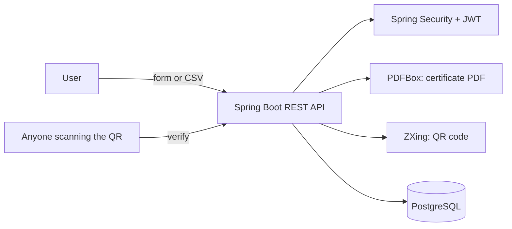

  

  

  
  
  

---

## 👋 Hi, I'm Akshita

I'm a Java and full-stack developer who likes the parts of an app users never see but always depend on: the APIs, the authentication, and the database queries that have to stay fast and correct.

I spent about a year maintaining publishing websites, then moved into Java and worked on Spring Boot APIs at Ypsilon IT Solutions. I've also built my own projects end to end, from PDF generation to JWT security to Docker deployment. I'm now looking for my first full-time role.

**📍 Based in:** Indore, India · open to relocating to Pune or Bengaluru, and to remote roles
**📬 Reach me:** akshitasharma0683@gmail.com · [LinkedIn](https://www.linkedin.com/in/akshita-sharma-188773219/) · [Portfolio](https://akshitasharma.dev)

---

## 💼 Experience

**Full Stack Java Intern · Ypsilon IT Solutions** *(Sep 2025 – Jun 2026)*
- Built and deployed REST APIs with Spring Boot and Hibernate/JPA, covering CRUD operations across relational databases.
- Improved search and data retrieval on a high-traffic operational insights platform by optimizing queries and adding custom filtering.
- Wrote unit and integration tests with JUnit and Mockito, and took part in peer code reviews.

**Web Application Developer · Granthaalayah Publications and Printers** *(Jun 2024 – Aug 2025)*
- Built and maintained a 25-page WordPress site, and fixed performance issues using PageSpeed Insights, PHP/JS fixes, and plugin configuration.
- Managed and customized approximately 8 Open Journal Systems (OJS) publication sites, troubleshooting workflows, integrations, and configuration problems.
- Set up and maintained 50+ automated email workflows (registration, manuscript submission, reviewer notifications, reminders, plagiarism reports, editorial assignments).

---

## 🚀 Projects

<table>
  <tr>
    <td width="50%" valign="top">
      <h3>📜 Smoly</h3>
      
      
<b>Certificate automation with QR verification.</b> I built it after seeing how much manual work certificate generation took at my previous job. It turns form inputs or a CSV into downloadable PDF certificates, each with a QR code anyone can scan to verify it.

      <ul>
        <li>JWT auth with Spring Security</li>
        <li>PDF generation with Apache PDFBox, QR codes with ZXing</li>
        <li>PostgreSQL persistence via JPA/Hibernate</li>
        <li>Dockerized and deployed</li>
      </ul>
      
<code>Java 17</code> <code>Spring Boot</code> <code>PostgreSQL</code> <code>Docker</code>

      <a href="https://smoly.onrender.com/">Live demo</a> · <a href="https://github.com/akshitasharma0683-dev/smoly">Code</a>
       Free hosting, so the first load can take about a minute to wake up.
    </td>
    <td width="50%" valign="top">
      <h3>💸 ExpenseFlow</h3>
      
<b>A secure personal finance backend.</b> Tracks expenses and income by category, and returns analytics such as weekly and monthly spending, balance, and recent transactions.

      <ul>
        <li>JWT, BCrypt, stateless security, request validation</li>
        <li>Each user can only access their own records (ownership checked against the authenticated user)</li>
        <li>Analytics computed with database-level JPA aggregation queries</li>
        <li>Tested with JUnit 5 and Mockito</li>
      </ul>
      
<code>Java 17</code> <code>Spring Boot</code> <code>PostgreSQL</code> <code>JUnit 5</code>

      <a href="https://github.com/akshitasharma0683-dev/paisalekha">Code</a>
    </td>
  </tr>
</table>

<table>
  <tr>
    <td width="30%">
      
    </td>
    <td valign="top">
      <h3>🛡️ Yagyasenna</h3>
      
A women's safety web app with SOS assistance, trusted contacts, a journey mode, a safety journal, and live maps.

      
<code>JavaScript</code> <code>Leaflet.js</code> <code>Geolocation API</code>

      <a href="https://akshitasharma0683-dev.github.io/yagyasenna/">Live demo</a> · <a href="https://github.com/akshitasharma0683-dev/yagyasenna">Code</a>
    </td>
  </tr>
</table>

---

## 🧱 How Smoly works

---

## 🛠️ Tech I work with

  

Also used on projects: 

**Day to day:** Java 17 · Spring Boot · Spring Security (JWT) · Hibernate/JPA · PostgreSQL · REST APIs
**Comfortable with:** JUnit 5 · Mockito · Postman · Docker · Git · Maven
**Also:** React · MySQL · JavaScript · HTML/CSS

---

## 📚 What I'm working on right now

- Building a React frontend for ExpenseFlow
- Deploying and containerizing my projects, and learning CI/CD
- Adding API documentation and more tests to my existing projects

---

## 📊 GitHub

  
  

<picture>
  <source media="(prefers-color-scheme: dark)" srcset="https://raw.githubusercontent.com/akshitasharma0683-dev/akshitasharma0683-dev/output/github-snake-dark.svg" />
  <source media="(prefers-color-scheme: light)" srcset="https://raw.githubusercontent.com/akshitasharma0683-dev/akshitasharma0683-dev/output/github-snake.svg" />
  
</picture>

---

## 🤝 Let's talk

If you're hiring for a Java, full-stack, or backend role, or just want to talk about something I've built, email me at **akshitasharma0683@gmail.com** or message me on [LinkedIn](https://www.linkedin.com/in/akshita-sharma-188773219/).

  

